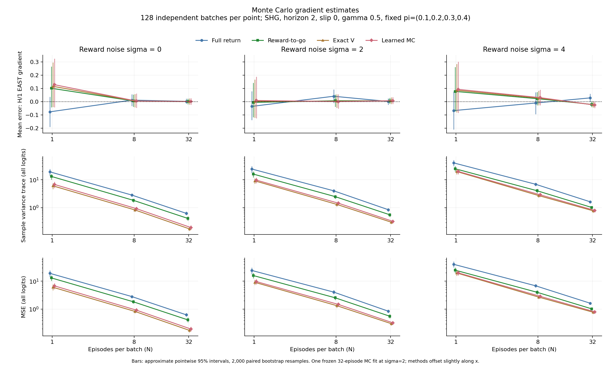
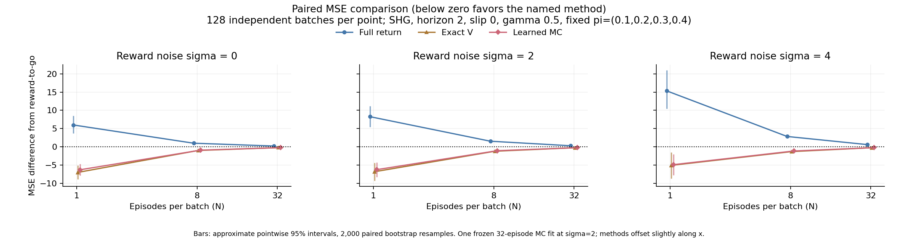

# Monte Carlo gradient noise and episode count

These selected figures compare the four existing estimators at one frozen
policy. The companion `summary.json` stores every plotted point and interval,
all coordinate summaries, settings, baseline values, versions, and collection
runtime. The notebook reads this summary directly; it does not rerun the sweep.



**Figure 1.** Each point summarizes B=128 independent batch estimates, each
averaging N complete episode gradient sums. Columns vary independent reward
noise sigma; the horizontal axis varies N. The first row shows the signed mean
error at the predetermined H/1 EAST logit (exact gradient +0.2). Its zero line
means agreement with the exact derivative. The other rows sum variance and
squared error across all 16 logits, including zero/unvisited rows. Variance
uses B-1; MSE is the mean squared error of an N-episode estimate, not the error
of the grand mean over all B batches. Positive variance/MSE panels use log
scales, and each row shares its vertical scale across noise levels. Slight
horizontal offsets separate the methods' interval bars.



**Figure 2.** Each curve subtracts reward-to-go MSE from the named method's MSE.
Below zero means lower error than reward-to-go in that setting. The comparison
uses the same episodes within each batch and the same bootstrap row indices
for all methods, preserving their covariance. Overlap of separate methods'
individual intervals is not the test used here.

All bars are approximate **pointwise 95% paired percentile-bootstrap intervals**,
from 2,000 resamples of whole batch vectors. They are conditional on this one
policy and fitted baseline. They do not give simultaneous coverage over all
coordinates/settings, account for new baseline fits, or guarantee coverage in
small/rare-event samples. More bootstrap replicates improve quantile precision;
they do not create additional observed episodes. The recorded resampling seeds
are 20261112..20261120. See the
[paired resampling and percentile definitions](https://docs.scipy.org/doc/scipy/reference/generated/scipy.stats.bootstrap.html).
The implementation uses NumPy; it does not add a SciPy dependency.

The summary retains squared empirical bias and its estimated mean-noise
contribution, but does not give the squared norm a naive percentile interval
and interpret it as evidence of true bias. Signed bias intervals are saved
for every coordinate; only the declared H/1 EAST coordinate is plotted.

## Settings and observations

- World: `SHG`, horizon 2, slip 0; step reward -1, hazard penalty -5, goal bonus 10.
- Frozen policy: probabilities (0.1, 0.2, 0.3, 0.4) in NORTH/EAST/SOUTH/WEST order
  at each cell/time row; gamma=0.5.
- Sweep: N=(1,8,32), sigma=(0,2,4), B=128. The four estimators share episodes
  within each batch. Batches and conditions use distinct seeds, 10000..25743,
  allocated in noise-major, then batch-size order.
- One learned MC table: 32 episodes, seeds 1000..1031, training sigma=2, complete
  return targets, zero for unseen states. The table stays fixed across the entire
  sweep, including probe sigma=0 and 4. Thus this comparison isolates probe noise
  rather than varying fit quality at the same time.
- Budget: 15,744 probe episodes / 31,488 transitions shared by the four methods,
  plus one 32-episode / 64-transition fit. Equal probe budgets do not mean equal
  total data costs; results do not average over different fits.
- Pilot: B=8, N=(1,8), sigma=(0,4), probe seeds 100000..100143. Its 144 probe
  episodes are excluded from final evidence. All choices were declared before
  collecting the full sweep.

For N=8, the observed MSEs (with pointwise 95% intervals) are:

| sigma | Full return | Reward-to-go | Exact V | Learned MC |
| ---: | ---: | ---: | ---: | ---: |
| 0 | 2.826 [2.467, 3.201] | 1.838 [1.582, 2.125] | 0.833 [0.719, 0.963] | 0.923 [0.788, 1.079] |
| 2 | 4.082 [3.470, 4.791] | 2.548 [2.133, 3.008] | 1.336 [1.124, 1.564] | 1.482 [1.236, 1.743] |
| 4 | 6.854 [5.971, 7.797] | 4.017 [3.390, 4.704] | 2.704 [2.316, 3.148] | 2.873 [2.441, 3.357] |

Larger batches reduce variance and MSE approximately with 1/N, while stronger
reward noise increases them. In all nine settings, the paired intervals put
full return above reward-to-go, and both baselines below reward-to-go. This is
evidence about these settings and this fit, not a universal variance ordering.
The separate exact-V and learned-baseline curves are close; their displayed
individual intervals do not establish a difference between those two methods.
All displayed H/1 EAST signed-bias intervals contain zero, which is consistent
with the earlier exact-expectation checks but is not a proof of unbiasedness.

Reward-to-go removes past-reward contributions that the current action cannot
affect. A baseline subtracts the predictable state-dependent return, but cannot
predict a new independent, zero-mean reward-noise draw. Action sampling remains
random even at sigma=0. There is no transition slip in this particular sweep.
The notebook derives the additional single-episode variance from reward noise:
1.75 sigma-squared for full return and 1.05 sigma-squared for all three RTG
variants. For an N-episode average, divide those contributions by N. These
coefficients describe this two-step policy and distinct time-specific logit
rows, not a general environment.

## Reproduction

From this checkout's `rl_math` directory:

```bash
uv sync --locked
uv run --locked python -m unittest discover -s tests -v
uv run --locked python -m gridworld.monte_carlo_sweep run --pilot --output-dir runs/mc-pilot --device cuda
uv run --locked python -m gridworld.monte_carlo_sweep run --output-dir runs/mc-sweep --device cuda
uv run --locked python -m gridworld.monte_carlo_sweep report runs/mc-sweep/sweep.json --output-dir runs/mc-replot
cmp runs/mc-sweep/summary.json runs/mc-replot/summary.json
cmp runs/mc-sweep/metrics.png runs/mc-replot/metrics.png
cmp runs/mc-sweep/paired_mse.png runs/mc-replot/paired_mse.png
```

Choose new output-directory names for reruns. `--device cpu` selects reference
collection; `report` needs no GPU and performs no collection, fitting, or exact
evaluation. The ignored raw `sweep.json` retains all 128-by-16 vectors for each
method/condition and every episode seed; the committed summary is the selected
figure source rather than a replacement for those raw vectors.

Recorded environment: Python 3.10.12, NumPy 2.2.6, PyTorch 2.14.1+cu130, CUDA 13.0,
Matplotlib 3.10.9, RTX 3090. Pilot command: 1.64 s. Full collection/setup/fit:
33.52 s; full command including analysis/serialization/figures: 35.78 s. The
initial full run briefly overlapped the validation suite, so these wall-clock
observations are not an isolated throughput benchmark. Rebuilding the report
from raw vectors took 2.19 s. Exact timing is not a reproducibility assertion.
